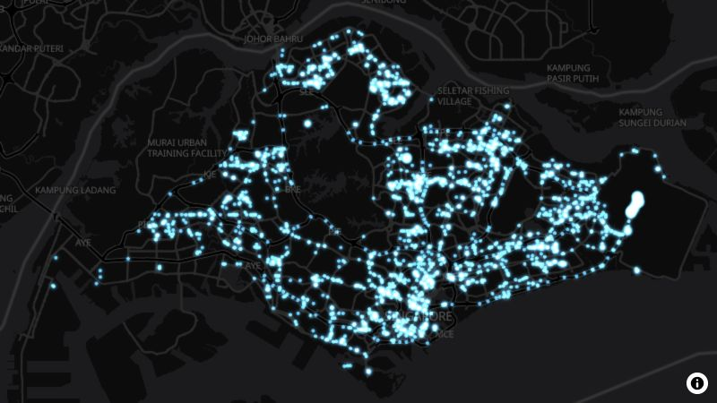
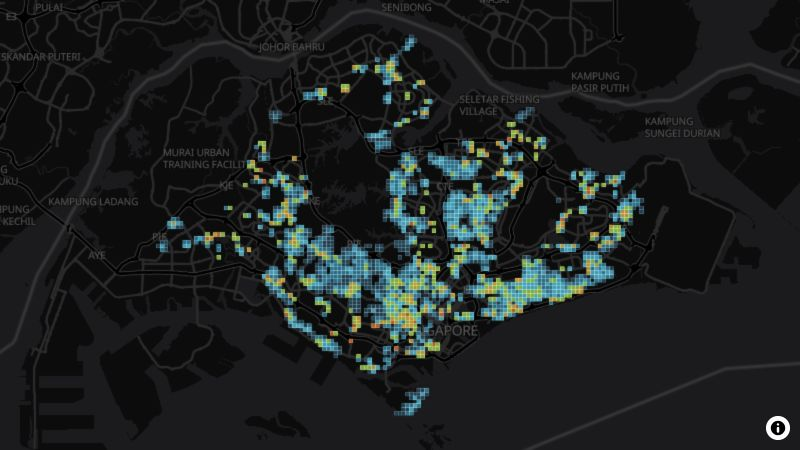
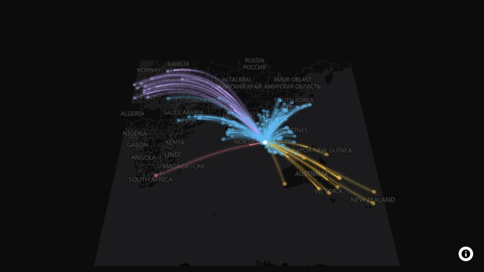
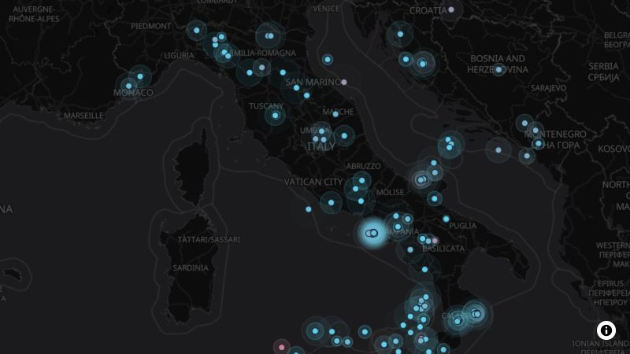
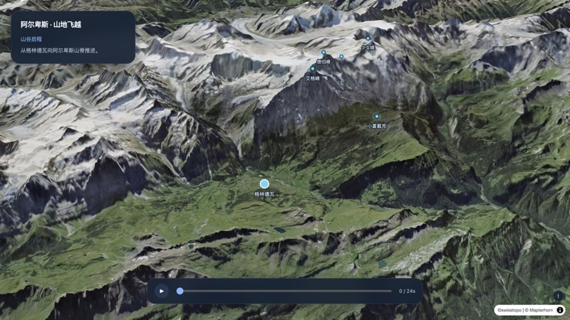

<p align="center">
  
</p>

<h1 align="center">Geo Data Viz</h1>

<p align="center"><strong>上传一份数据，让 AI 帮你看见空间里的故事。</strong></p>
<p align="center">分析地理数据 · 生成交互地图 · 编排地理场景与视频</p>

<p align="center">
  <a href="#examples">示例体验</a> ·
  <a href="#getting-started">安装使用</a> ·
  <a href="#visuals">效果展示</a> ·
  <a href="#docs">文档</a> ·
  <a href="https://www.npmjs.com/package/@floracat/geo-data-viz">npm</a>
</p>

Geo Data Viz 是用于 **Codex、Claude Code 等 Agent 的地理数据可视化 Skill**。上传 CSV、Excel、JSON 或 GeoJSON，告诉 Agent 你想观察什么，它会检查数据、选择合适的地图表达，并生成可运行的 HTML 文件。需要讲述地点与路线故事时，可编排章节、镜头和媒体，按需生成 Remotion 视频工程并导出 MP4。

未指定地图服务且没有已授权 Key 时，默认使用 **MapLibre + OpenFreeMap**，无需申请 Key。指定 Mapbox 等服务时，沿用对应图商及已授权配置。

## 从数据到地图

- **先理解数据**：识别地理字段、坐标系、指标和空间分布，检查缺失值与异常值。
- **按问题选择表达**：用气泡比较规模，用热力观察密度，用路线呈现网络，用区域设色或 3D 展示空间差异；全球数据可选择球面飞线、区域设色与指标柱。
- **只处理用户提供的数据**：不会调用算路、地理编码或外部业务数据补全接口；缺少路径几何时仅展示站点顺序或明确标注的连接示意。
- **交付可使用的结果**：生成独立 HTML，按任务加入效果切换、搜索、筛选、悬停详情，以及深色／浅色主题。
- **让背景服务于表达**：地图数据组件可配置矢量、影像或真实地形底图；影像与 DEM 使用你提供或已授权的资源，默认 OpenFreeMap 仍无需 Key。
- **讲述空间里的故事**：用日期浏览行程，用时间轴展开事件，或用镜头、路线揭示、地点标注、图片、字幕和已有旁白制作地理解说；静态地图、MapTiler 和 Cesium 三维飞越都归入场景叙事。
- **尊重你的地图选择**：优先使用图商原生图层或官方扩展；能力不足时再用 deck.gl、ECharts、Canvas 等补充。多图商切换按需求加入。

数据和目标明确时直接推进；只在坐标系、指标含义、Key 等关键事项缺失时询问。具体效果取决于数据结构与所选地图服务，详见[能力参考](references/capabilities/index.md)。

<a id="examples"></a>

## 先体验一张地图

仓库附带 12 个可运行 HTML 示例，默认示例中心按**地图数据可视化、地球模式可视化、场景叙事可视化**三类浏览：

| 类别 | 代表数据 | 可视化与交互 |
| --- | --- | --- |
| 地图数据可视化 | 新加坡发光散点、私人住宅、历史航空飞线、出租车快照；美国公路历史事故、意大利及周边地震事件 | 柔光与颜色叠加、区域设色与 3D、飞线、指标线、呼吸点、分时热力、深色地图 / 卫星图切换 |
| 地球模式可视化 | 全球航空连接、人口、地震 | 球面飞线、区域设色、球面棱柱 |
| 场景叙事可视化 | 新加坡两日漫游、六章节故事、阿尔卑斯山地飞越 | 日期切换与地点详情；时间轴播放与轨迹展开；真实地形与 24 秒四章节镜头 |

```bash
git clone https://github.com/FloraCat526/geo-data-viz.git
cd geo-data-viz
npm run examples
```

打开 **[http://127.0.0.1:8000/](http://127.0.0.1:8000/)**。需要 Node.js 20+，无需 `npm install`、构建或地图 Key；SDK、字体与底图需要联网。

端口被占用时运行 `npm run examples -- --port 8001`。也可使用 Python：

```bash
python3 -m http.server 8000 --bind 127.0.0.1 --directory examples
```

发光散点、住宅、航空飞线与地震呼吸点使用统一组件接口；公路事故的指标线宽与出租车的快照切换属于页面定制。每个示例的实际调用方式见[示例清单](examples/README.md)。Skill 的完整能力列表见文末，默认示例中心只展示精选作品。地球模式使用独立 Globe.GL WebGL 渲染器，无需地图 Key，但并非 MapLibre 原生图层；[组件说明](references/globe-effects.md)列出字段、语义与限制。

[示例运行与重建](examples/README.md) · [数据来源与统计口径](examples/SOURCES.md)

示例用于体验生成结果，不是 Skill 的运行依赖，也不随 npm 安装器复制。GitHub 中的 HTML 文件需下载后通过本地服务打开。

<a id="getting-started"></a>

## 安装使用

### 1. 安装到你的 Agent

需要 Node.js 20+。选择对应的技能目录：

**Codex**（默认安装至 `~/.agents/skills/geo-data-viz`）：

```bash
npx @floracat/geo-data-viz@latest install
```

**Claude Code**：

```bash
npx @floracat/geo-data-viz@latest install --dir ~/.claude/skills
```

**WorkBuddy 或其他兼容 Agent**：使用宿主配置的技能目录；`--dir` 指向其父目录，安装器会追加 `geo-data-viz`。

```bash
npx @floracat/geo-data-viz@latest install --dir /path/to/skills
```

> 已有安装可在对应安装命令后加 `--force` 更新，安装器会先备份旧版本。需要使用仓库中尚未发布的改动时，可在克隆后的仓库根目录运行 `node bin/geo-data-viz.mjs install --force`；其他宿主沿用对应的 `--dir` 参数。案例运行命令仅用于 GitHub 源码，案例网站不随 npm 包安装。

安装后若 Agent 未识别 Skill，重启或重新加载技能。安装器只复制 Skill 文件；数据分析另需 Python 3.10+，Excel 的可选依赖见下方说明。

### 2. 上传数据，描述你想观察什么

在 Codex 中上传文件并输入：

```text
使用 $geo-data-viz 分析这份门店 CSV。
经纬度为 WGS84，我想比较各门店订单量，并观察门店集中在哪些区域。
选择合适的可视化方式，支持深浅主题，生成可交互的 HTML 地图。
```

Claude Code 可通过 `/geo-data-viz` 调用；其他 Agent 按宿主的 Skill 调用方式使用。

想使用已有图商配置时，可以补充：

```text
使用 Mapbox，读取本任务已授权的 MAPBOX_ACCESS_TOKEN 环境变量。
根据数据选择合适的原生图层，生成 HTML 地图。
```

已有的授权配置会复用。明确指定图商但缺少 Key 时，Agent 会补充必要配置，不会静默更换图商。只有地址的数据需要先完成地理编码。

需要地形或视频时，可这样描述：

```text
使用我上传的旅游地点和路线，按日期编排章节与镜头。
使用本任务提供的影像/DEM 配置展示地形，保留原始路线几何。
生成可播放的 HTML；再生成 Remotion 工程并导出 30 FPS 的 MP4。
```

普通 HTML 无需 Remotion。视频工具先生成独立工程，实际导出另需 Node.js 20+、依赖和支持 WebGL 的 Chromium；图片/旁白使用已提供的文件。地图资源与视频的实际验证范围见[底图](references/basemaps.md)及[视频输出](references/video-export.md)。

### 3. 打开生成结果

默认交付 `map.html`，内嵌必要数据与业务代码，SDK 和底图仍需联网。需要 HTTP 服务或外部大文件时，Agent 会同时交付相关文件与启动命令。

Agent 应验证地图是否实际显示、数据是否正确落位，以及本次需要的交互是否可用；仅生成文件或成功加载 SDK 不等于完成展示。

<details>
<summary>安装到当前项目、更新与预览安装清单</summary>

```bash
# 安装到当前项目的 .agents/skills/geo-data-viz
npx @floracat/geo-data-viz@latest install --project

# 更新默认安装，自动备份旧目录
npx @floracat/geo-data-viz@latest install --force

# 更新自定义目录时，保留原来的目录参数
npx @floracat/geo-data-viz@latest install --dir /path/to/skills --force

# 仅查看目标与文件清单，不写入
npx @floracat/geo-data-viz@latest install --dry-run --force
```

默认安装的备份位于 `~/.agents/.geo-data-viz-backups/`。安装包检查方法见 [安装包下载与校验](references/installation-review.md)。

</details>

<details>
<summary>Excel 依赖与手动数据分析</summary>

CSV、JSON、GeoJSON 的基础分析无需额外 Python 依赖。Excel XLSX/XLSM 可在虚拟环境中安装：

```bash
python3 -m venv .venv
source .venv/bin/activate
python3 -m pip install -r "$HOME/.agents/skills/geo-data-viz/requirements-excel.txt"
```

通常由 Agent 调用分析脚本，也可以手动运行：

```bash
python3 "$HOME/.agents/skills/geo-data-viz/scripts/profile_geo.py" \
  /path/to/stores.csv --out-dir ./work/profile \
  --crs wgs84 --lng-field longitude --lat-field latitude --value-field orders
```

按实际安装目录、数据字段与坐标系调整命令。

</details>

<a id="visuals"></a>

## 效果展示

以下预览来自仓库附带的公开示例，点击名称可查看对应 HTML 源码，下载后通过示例中心运行。预览与示例中心共用图片，避免重复保存历史截图。

| | |
| --- | --- |
| **[新加坡发光散点](examples/maps/point-glow.html)**<br> | **[新加坡住宅 · 3D](examples/maps/housing.html)**<br> |
| **[新加坡历史航线 · 飞线](examples/maps/flights.html)**<br> | **[意大利地震 · 波纹](examples/maps/quakes.html)**<br> |

<details>
<summary>地球模式与场景叙事</summary>

| | |
| --- | --- |
| **[全球航空连接](examples/maps/globe-flights.html)**<br> | **[球面棱柱](examples/maps/globe-earthquakes.html)**<br> |
| **[新加坡两日漫游](examples/maps/travel-itinerary.html)**<br> | **[阿尔卑斯山地飞越](examples/maps/mountain-flyover.html)**<br> |

</details>

<a id="docs"></a>

页面支持中文与英文（`locale: zh-CN | en`）；记录列表默认隐藏，按需启用。配置拼写错误会返回修正提示，临时地图资源错误恢复后会自动更新状态。

## 文档与开发

| 你想做什么 | 从这里开始 |
| --- | --- |
| 理解 Skill 的完整工作流 | [SKILL.md](SKILL.md) |
| 理解统一组件接口与源码职责 | [类参考手册](references/class-reference.md) · [组件清单](references/visualizations.md) · [实现架构](references/architecture.md) |
| 检查字段、坐标系与指标语义 | [数据契约](references/data-contract.md) |
| 选择适合数据的可视化 | [选型指南](references/selection.md) |
| 生成 HTML、配置图商与凭证 | [生成指南](references/generation.md) |
| 配置影像、地形与高程来源 | [底图配置](references/basemaps.md) |
| 编排章节、镜头、路线与媒体 | [场景镜头组件](references/scene-narrative.md) |
| 生成 Remotion 工程并导出 MP4 | [视频输出](references/video-export.md) |
| 调整深浅主题、布局与交互 | [主题](references/themes.md) · [布局与交互](references/presentation.md) |
| 处理轨迹、OD 与区域关联 | [数据转换](references/transforms.md) |
| 核对效果的渲染来源 | [原生优先与补充效果](references/provider-rendering.md) |
| 查看已验证范围与版本变化 | [验证边界](references/verification.md) · [更新日志](CHANGELOG.md) |

仓库中，`scripts/` 提供数据分析、HTML 和视频工程生成入口，`references/` 提供选型和图商知识，`assets/components/visualizations.mjs` 提供平面可视化组件的统一注册表和接口，`assets/recipes/` 是组件内部复用的 SDK 图层实现，`assets/shared/` 保存颜色、图例/统计、主题和底图等公共逻辑；`assets/video/` 是可选 Remotion 模板，`examples/` 保存可运行示例。

欢迎通过 [GitHub Issues](https://github.com/FloraCat526/geo-data-viz/issues) 提交问题或建议；反馈地图问题时，请提供脱敏数据样例、图商、预期效果和错误信息，不要附上私密凭证。

中国地图相关任务须遵循适用的地图合规要求，保留必要的版权、地图标识和审图信息；宿主提供内置地图合规 Skill 时，按其指导执行。示例数据的来源和许可单独记录在 [来源说明](examples/SOURCES.md)。

## 许可证

项目代码与文档采用 [MIT License](LICENSE)，版权署名为 FloraCat526。复制或分发本项目代码时保留许可声明；生成器会将声明内嵌在 HTML 注释中，不占用地图界面。Remotion、第三方地图 SDK、影像、DEM、字体、媒体和示例数据遵循各自许可与服务条款，用户上传的数据不因使用本 Skill 而改变权属或许可。
